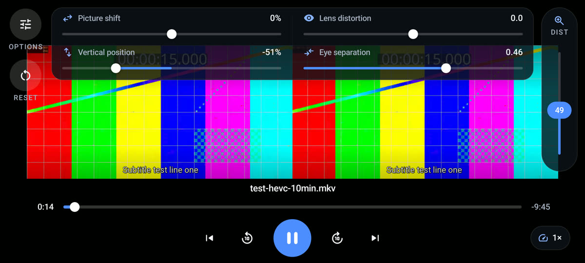
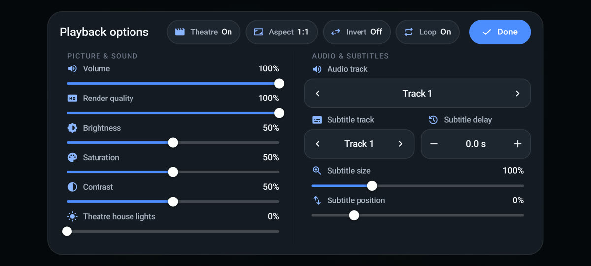
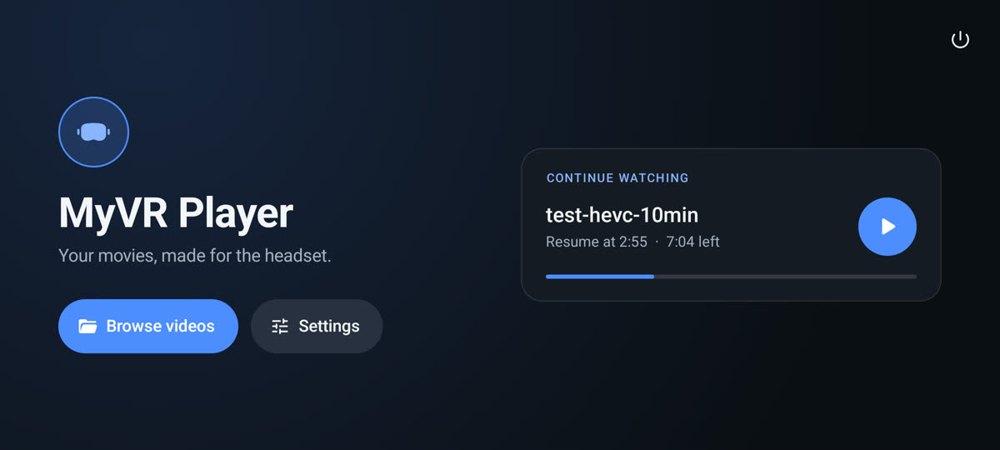
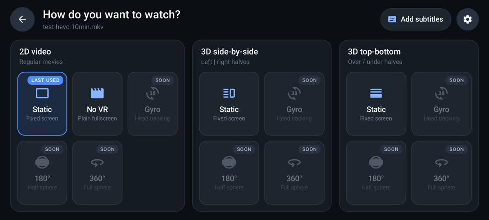

# MyVR Player

A side-by-side VR video player for Android phone headsets (Cardboard-style viewers).
Pick a movie from your phone, slide the phone into the headset, and watch it on a big fixed
screen, optionally inside a dark cinema hall. No head tracking, no fuss.

**[⬇ Download the latest APK](https://github.com/abhiguptag22/myvr-player/releases/latest/download/MyVR-Player.apk)**
· Android 8.0+ · ARM phones · [All releases](https://github.com/abhiguptag22/myvr-player/releases)

<p>
  
  
  
  
</p>

## Features

- **Plays almost anything**: MKV, MP4, AVI, HEVC/H.265, AC3/DTS audio, embedded and external subtitles (powered by libVLC).
- **Fit it to your headset**: screen distance, eye separation, vertical position, picture shift and lens distortion, all adjustable live and remembered.
- **Modes**: 2D static screen, plain fullscreen, 3D side-by-side and 3D top-bottom.
- **Cinema mode**: a dark cinema hall around the screen, lit by the film itself. It moves and scales with your screen settings, and the house lights are adjustable.
- **Bluetooth remote friendly**: play/pause, ±10 s and next/previous work from headset buttons, media remotes and keyboard-style remotes.
- **Reliable seeking on long movies**: one seek per drag, no overlapping seeks, and a watchdog that recovers if the decoder ever stalls.
- **Resume where you left off**, with a "Continue watching" card on the home screen and progress bars in the file browser.
- **Subtitles**: track picker, size, position and **subtitle delay** (0.5 s steps, remembered per movie).
- **Picture and sound**: volume, brightness, contrast, saturation, render quality, aspect ratio override, speed (0.5×–4×), loop.
- **White screen** button for spotting dust on the screen or lenses.
- Edge to edge on phones with a camera cut-out.

## Install

1. On your phone, open the [download link](https://github.com/abhiguptag22/myvr-player/releases/latest/download/MyVR-Player.apk) and install the APK
   (allow "Install unknown apps" for your browser when asked).
2. Open **MyVR Player**, tap **Browse videos** and allow **All files access** so it can read your movie folders.
3. Pick a movie, choose **Static**, and put the phone in your headset.

## Build from source

Requirements: JDK 17 and the Android SDK (platform 34, build-tools 34).

```sh
cd app
./gradlew assembleDebug        # app/build/outputs/apk/debug/app-debug.apk
```

Release builds are signed with a key kept outside the repository: point `MYVR_KEYSTORE_PROPERTIES`
at a properties file containing `storeFile`, `storePassword`, `keyAlias` and `keyPassword`, then run
`./gradlew assembleRelease`.

## Project layout

- `app/`: Android project (Kotlin, libVLC 3.6, OpenGL ES 2 renderer)
- `docs/theatre.md`: how the cinema background was made

## License

MIT, see [LICENSE](LICENSE). Bundled third-party components (libVLC, Material Symbols, the CC0
cinema image) are listed in [NOTICE.md](NOTICE.md).
